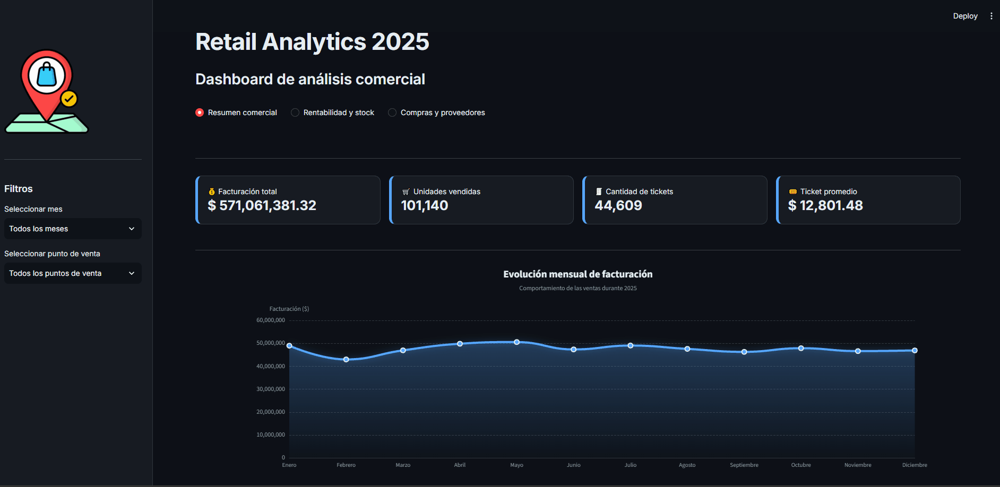
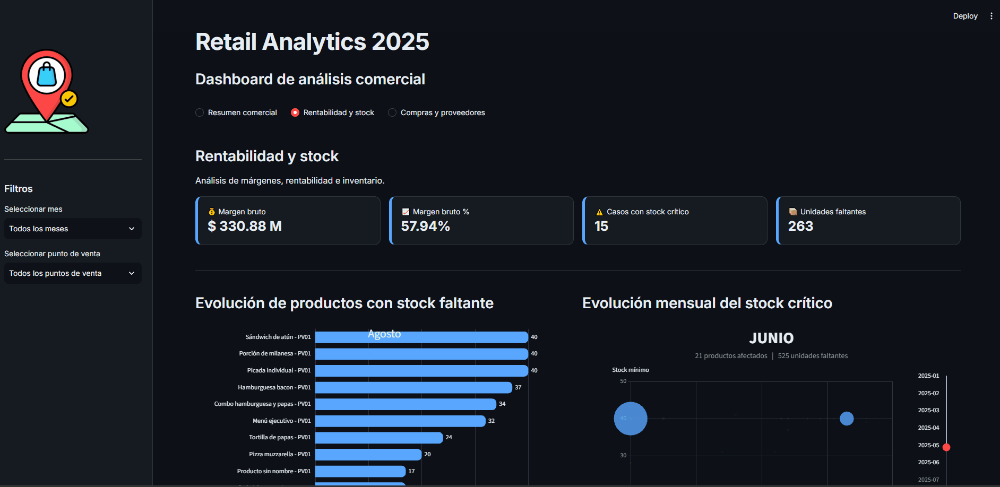
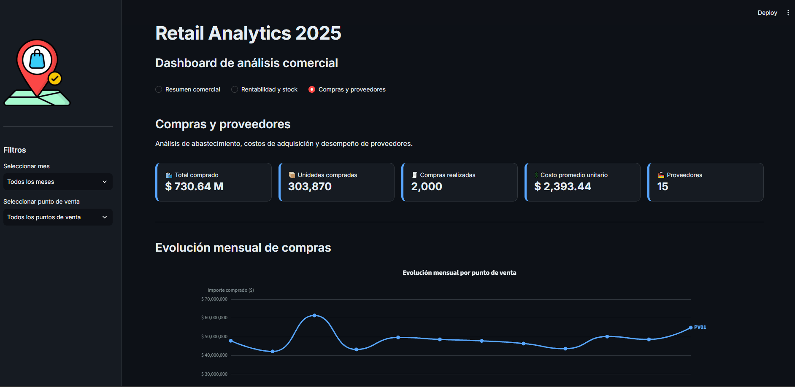

# 🛒 Retail Analytics 2025 – Análisis Comercial

### Dashboard Web Interactivo | Data Analytics | Business Intelligence

Proyecto de **análisis de datos comerciales** desarrollado para evaluar el desempeño de un negocio durante el año 2025, mediante información de ventas, productos, puntos de venta, compras, proveedores y stock.

El proyecto integra procesamiento de datos con **Python y Pandas**, consultas mediante **SQL**, almacenamiento en **SQLite** y visualizaciones interactivas a través de **Streamlit y Apache ECharts**.

---

## 📌 Descripción del proyecto

El objetivo principal es transformar datos comerciales en información útil para la gestión y la toma de decisiones empresariales.

A través del análisis de ventas, rentabilidad, inventario, compras y proveedores, se busca identificar oportunidades de mejora, evaluar el rendimiento de los distintos puntos de venta y facilitar el seguimiento de los principales indicadores del negocio.

Los resultados se presentan mediante una aplicación web interactiva que permite explorar información comercial desde diferentes perspectivas.

## 🎯 Objetivos

- Analizar la **facturación** y el **volumen de ventas**.
- Identificar los productos y categorías con mayor participación.
- Comparar el rendimiento de los distintos puntos de venta.
- Evaluar márgenes y rentabilidad.
- Analizar compras y desempeño de proveedores.
- Detectar situaciones de stock crítico.
- Presentar indicadores mediante dashboards interactivos.

## 🖥️ Vista previa del dashboard

Aplicación web interactiva desarrollada con **Streamlit**.



## 🛠️ Proceso de trabajo y herramientas utilizadas

El proyecto se desarrolló mediante distintas etapas, utilizando cada tecnología según su función dentro del proceso de análisis.

### 1. 🧹 Preparación y limpieza de datos con Python

Se utilizó **Python** para realizar el proceso de preparación, limpieza y transformación de los datos.

Entre las tareas realizadas se incluyen:

- Exploración inicial de los conjuntos de datos.
- Revisión de registros y estructura de las tablas.
- Detección y tratamiento de datos faltantes.
- Identificación y eliminación de registros duplicados.
- Corrección de inconsistencias.
- Validación de tipos de datos y formatos.
- Transformación y preparación de la información para el análisis.

Se utilizaron principalmente **Python y Pandas** para garantizar la calidad y consistencia de los datos.

### 2. 🗄️ Consultas y análisis con SQL

Se utilizó **SQL** para consultar y analizar la información almacenada en la base de datos SQLite.

Se desarrollaron consultas para:

- Calcular indicadores comerciales.
- Analizar ventas por período, producto, categoría y punto de venta.
- Obtener información sobre compras y proveedores.
- Calcular márgenes de rentabilidad.
- Analizar niveles de inventario.
- Generar resultados agrupados y rankings para los dashboards.

Las consultas SQL permiten extraer, relacionar y organizar la información necesaria para cada indicador y visualización.

### 3. 🔗 Base de datos SQLite e integración con Streamlit

La información se organizó en una base de datos **SQLite**, que funciona como fuente de datos del proyecto.

Mediante **Python y SQLite** se estableció la conexión entre la base de datos y la aplicación desarrollada con Streamlit.

De esta manera, los dashboards ejecutan consultas sobre la base de datos y muestran los resultados directamente en la aplicación, sin necesidad de cargar manualmente los datos cada vez que se consulta un indicador.

### 4. 📊 Desarrollo de dashboards con Streamlit

Se desarrolló una aplicación web interactiva con **Streamlit**, organizada en tres módulos principales:

**📈 Resumen comercial**

- Facturación total.
- Unidades vendidas.
- Cantidad de tickets.
- Ticket promedio.
- Análisis de ventas por período, producto, categoría y punto de venta.

**💰 Rentabilidad y stock**

- Margen bruto.
- Porcentaje de margen.
- Productos con stock crítico.
- Unidades faltantes.
- Análisis de rentabilidad e inventario.

**🛒 Compras y proveedores**

- Total comprado.
- Unidades compradas.
- Cantidad de compras.
- Costo promedio unitario.
- Análisis de proveedores y abastecimiento.

## 📷 Capturas de pantalla

### 📈 Resumen comercial


### 💰 Rentabilidad y stock



### 🛒 Compras y proveedores



## 💻 Tecnologías utilizadas

| Tecnología | Aplicación |
|---|---|
| Python | Limpieza, transformación y procesamiento de datos |
| Pandas | Manipulación y análisis de datos |
| SQL | Consultas y extracción de información |
| SQLite | Almacenamiento en base de datos relacional |
| Streamlit | Desarrollo de la aplicación web |
| Apache ECharts | Creación de visualizaciones y gráficos |
| HTML5 | Estructura de la aplicación |
| CSS3 | Personalización del diseño |
| Jupyter Notebook | Exploración y desarrollo del análisis |

## 📂 Estructura del proyecto

```text
DASHBOARD_RETAIL_ANALYTICS/
│
├── app.py
├── consultas.py
├── conexion.py
│
├── dashboards/
│   ├── resumen_comercial.py
│   ├── rentabilidad_stock.py
│   └── compras_proveedores.py
│
├── graficos/
│
├── assets/
│   ├── style.css
│   ├── logo_retail.png
│   └── capturas/
│       ├── dashboard.gif
│       ├── resumen_comercial.png
│       ├── rentabilidad_stock.png
│       └── compras_proveedores.png
│
└── README.md
```

La **base de datos SQLite** se encuentra en la carpeta SQL del proyecto y es utilizada por la aplicación mediante la conexión configurada en Python.

## ⚙️ Funcionalidades

- Visualización de indicadores KPI.
- Navegación entre tres módulos de análisis.
- Consultas dinámicas a la base de datos SQLite.
- Análisis de ventas por período y punto de venta.
- Evaluación de rentabilidad y niveles de inventario.
- Análisis de compras y proveedores.
- Gráficos interactivos para facilitar la interpretación de resultados.
- Interfaz web con diseño personalizado.

## 💡 Resultados y conclusiones

El proyecto integra distintas etapas del análisis de datos: preparación y limpieza con **Python**, consultas con **SQL**, almacenamiento en **SQLite** y visualización mediante una aplicación web desarrollada con **Streamlit**.

El resultado es una herramienta de análisis comercial que permite explorar indicadores, evaluar el desempeño del negocio y obtener información relevante para la toma de decisiones.

La integración de estas tecnologías demuestra cómo los datos pueden transformarse en información organizada y visualmente accesible para el seguimiento de la actividad comercial.

## ⚠️ Consideraciones

- Los datos utilizados son ficticios y corresponden al año 2025.
- El proyecto tiene fines educativos y de portfolio profesional.
- Los indicadores se calculan a partir de la información disponible en la base de datos.
- Los resultados representan un ejercicio de análisis comercial y no información contable de una empresa real.

---

## 👩‍💻 Autora

**Gladys Ramos**

Data Analytics | Business Intelligence | Desarrollo Web

**Proyecto desarrollado con fines de práctica y portfolio profesional.**
